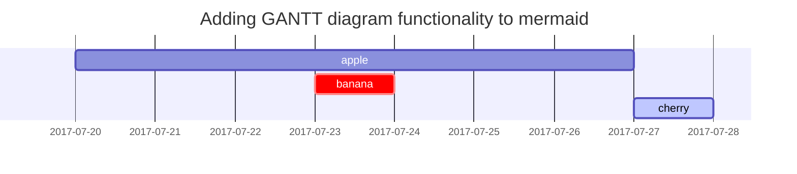
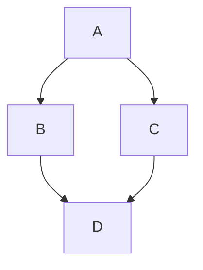

*Placeholder image*

## Headings

{/* markdownlint-capture */}
{/* markdownlint-disable */}

# H1 - heading

## H2 - heading

### H3 - heading

#### H4 - heading

##### H5 - heading

###### H6 - heading

{/* markdownlint-restore */}

## Paragraph

Quisque egestas convallis ipsum, ut sollicitudin risus tincidunt a. Maecenas interdum malesuada egestas. Duis consectetur porta risus, sit amet vulputate urna facilisis ac. Phasellus semper dui non purus ultrices sodales. Aliquam ante lorem, ornare a feugiat ac, finibus nec mauris. Vivamus ut tristique nisi. Sed vel leo vulputate, efficitur risus non, posuere mi.

Nullam tincidunt bibendum rutrum. Proin commodo ornare sapien. Vivamus interdum diam sed sapien blandit, sit amet aliquam risus mattis. Nullam arcu turpis, mollis quis laoreet at, placerat id nibh. Suspendisse venenatis eros eros.

## Lists

### Ordered list

1. Firstly
2. Secondly
3. Thirdly

### Unordered list

- Chapter
  - Section
    - Paragraph

### ToDo list

- [ ] Job
  - [x] Step 1
  - [x] Step 2
  - [ ] Step 3

## Block Quote

> This line shows the _block quote_.

> 장문의  
> 인용구  
> 테스트

## Prompts

:::tip
An example showing the `tip` type prompt.
:::

:::info
An example showing the `info` type prompt.
:::

:::warning
An example showing the `warning` type prompt.
:::

:::danger
An example showing the `danger` type prompt.
:::

## Tables

| Company                      | Contact          | Country |
| :--------------------------- | :--------------- | ------: |
| Alfreds Futterkiste          | Maria Anders     | Germany |
| Island Trading               | Helen Bennett    |      UK |
| Magazzini Alimentari Riuniti | Giovanni Rovelli |   Italy |

## Links

[http://127.0.0.1:4000](http://127.0.0.1:4000)

## Footnote

Clicking the hook will locate the footnote[^footnote], and here is another footnote[^fn-nth-2]. Notice they have hovering effect.

## Inline code

This is an example of `Inline Code`.

## Code blocks

### Common

{/* markdownlint-disable-next-line MD040 */}
```
This is a common code snippet, without syntax highlight and line number.
```

### Specific Language

```bash
if [ $? -ne 0 ]; then
  echo "The command was not successful.";
  #do the needful / exit
fi;
```

### Specific filename

```sass
@import
  "colors/light-typography",
  "colors/dark-typography";
```

## Mathematics

The mathematics powered by [**KaTeX**](https://katex.org/):

$$
\begin{equation}
  \sum_{n=1}^\infty 1/n^2 = \frac{\pi^2}{6}
\end{equation}
$$

We can reference the equation as $(1)$.

When $a \ne 0$, there are two solutions to $ax^2 + bx + c = 0$ and they are

```math
x = {-b \pm \sqrt{b^2-4ac} \over 2a}
```

## Mermaid SVG



## Images

### Default (with caption)


*Full screen width and center alignment*

:x[]{ .rounded-10 .border }
*Full screen width and center alignment*

### Left aligned


*Full screen width and center alignment*

### Float to left

:left[]{ .w-50 }
*Full screen width and center alignment*
Praesent maximus aliquam sapien. Sed vel neque in dolor pulvinar auctor. Maecenas pharetra, sem sit amet interdum posuere, tellus lacus eleifend magna, ac lobortis felis ipsum id sapien. Proin ornare rutrum metus, ac convallis diam volutpat sit amet. Phasellus volutpat, elit sit amet tincidunt mollis, felis mi scelerisque mauris, ut facilisis leo magna accumsan sapien. In rutrum vehicula nisl eget tempor. Nullam maximus ullamcorper libero non maximus. Integer ultricies velit id convallis varius. Praesent eu nisl eu urna finibus ultrices id nec ex. Mauris ac mattis quam. Fusce aliquam est nec sapien bibendum, vitae malesuada ligula condimentum.

### Float to right

:right[]{ .w-50 }
*Full screen width and center alignment*
Praesent maximus aliquam sapien. Sed vel neque in dolor pulvinar auctor. Maecenas pharetra, sem sit amet interdum posuere, tellus lacus eleifend magna, ac lobortis felis ipsum id sapien. Proin ornare rutrum metus, ac convallis diam volutpat sit amet. Phasellus volutpat, elit sit amet tincidunt mollis, felis mi scelerisque mauris, ut facilisis leo magna accumsan sapien. In rutrum vehicula nisl eget tempor. Nullam maximus ullamcorper libero non maximus. Integer ultricies velit id convallis varius. Praesent eu nisl eu urna finibus ultrices id nec ex. Mauris ac mattis quam. Fusce aliquam est nec sapien bibendum, vitae malesuada ligula condimentum.

### Dark/Light mode & Shadow

The image below will toggle dark/light mode based on theme preference.

{: .img-light .border }
{: .img-dark }

## Video

### YouTube

::youtube{id="jNQXAC9IVRw"}

## Reverse Footnote

[^footnote]: The 1st footnote source: Quisque egestas convallis ipsum, ut sollicitudin risus tincidunt a. Maecenas interdum malesuada egestas. Duis consectetur porta risus, sit amet vulputate urna facilisis ac. Phasellus semper dui non purus ultrices sodales. Aliquam ante lorem, ornare a feugiat ac, finibus nec mauris. Vivamus ut tristique nisi. Sed vel leo vulputate, efficitur risus non, posuere mi. Nullam tincidunt bibendum rutrum. Proin commodo ornare sapien. Vivamus interdum diam sed sapien blandit, sit amet aliquam risus mattis. Nullam arcu turpis, mollis quis laoreet at, placerat id nibh. Suspendisse venenatis eros eros.
[^fn-nth-2]: The 2nd footnote source.

## Math and Charts

Here is an inline math equation: $E=mc^2$.

And a block equation:

$$
\frac{n!}{k!(n-k)!} = \binom{n}{k}
$$

Here is a mermaid chart:


